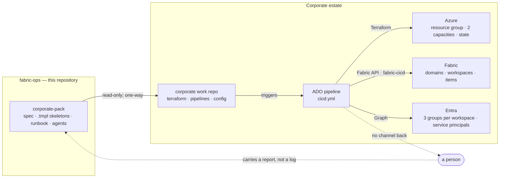
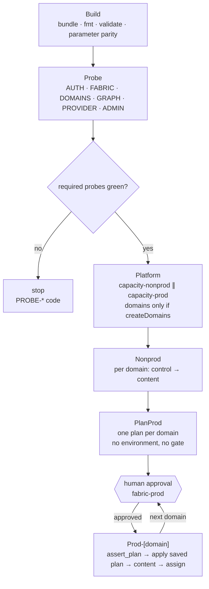
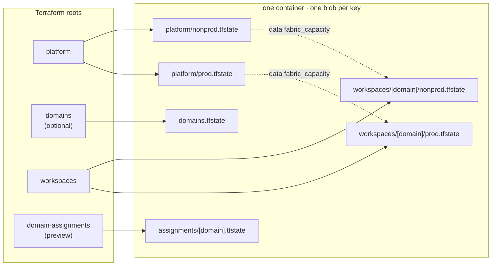
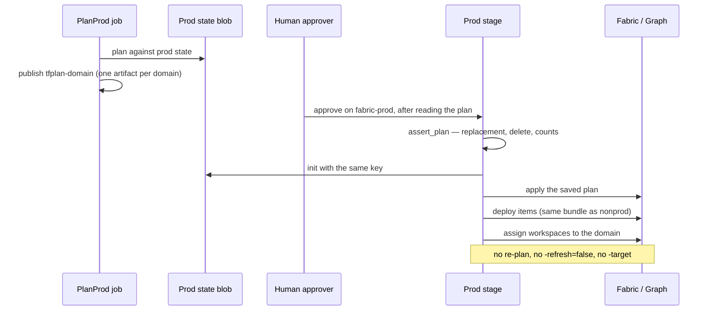

# The corporate deployment pipeline, mapped

**Dated 2026-11-27.** How a change travels from this repository to the corporate tenant, and where
each gate sits. Sources: [`corporate-pack/spec/0002-contract.md`](../reference/corporate-pack/spec/0002-contract.md),
[`spec/0001-decisions.md`](../reference/corporate-pack/spec/0001-decisions.md) and
[`spec/0004-assumptions.md`](../reference/corporate-pack/spec/0004-assumptions.md).

## 1. The one-way channel

The corporate machine reads this repository and copies the pack; nothing is pushed back. That is why
the pack carries its own probes, baselines and troubleshooting index.

## 2. The stage graph

The gate is the `environment:` line. An approval that times out marks the stage **skipped**, not
failed, so read the stage result, not the run colour.

## 3. Where the plans and states live

A plan is made against one blob and applied to it. It is never promoted between environments or
domains — that is why `PlanProd` exists.

## 4. One production deploy, in order

## 5. What is automated, and what stays human

| Step | Who | Gate |
| --- | --- | --- |
| Copy the pack, fill placeholders | corporate engineer, one `scaffold.sh` | `check-pack.sh` clean |
| Probe the tenant, read-only | pipeline | `PROBE-*` green |
| Create capacities | pipeline | `fabric-platform` approval (optional) |
| Create domains | **human by default**; pipeline only assigns | `PROBE-ADMIN` decides whether the optional root may run |
| Create a repository per nonprod workspace | human | run-book 00 |
| Create workspace, groups, identity, grants | pipeline | `fabric-nonprod` |
| Plan production | pipeline | read-only |
| Approve production | **human** | `fabric-prod`, one per domain |
| Apply production | pipeline | `assert_plan` + the approval |
| Pause a capacity | human | never scheduled |
| Report a failure | **a person carries the archive** | `scripts/report.sh` |

The rule behind the table: **agents plan, humans approve, the pipeline applies.** No agent holds a
production credential, and no step depends on a question travelling back to this repository.
