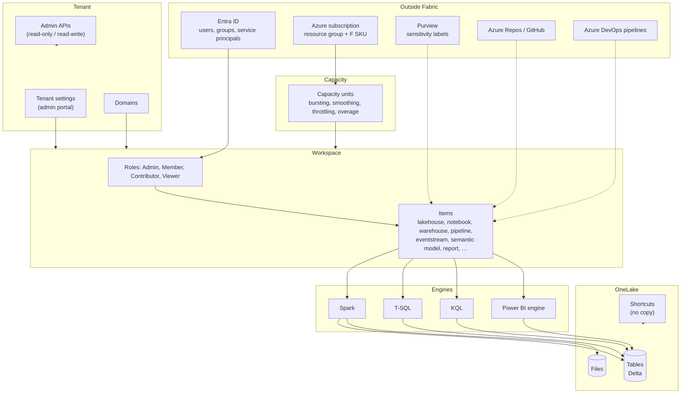

# The Fabric system, mapped

**Dated 2026-11-12.** A map of the platform as this project understands it: what the parts are,
what contains what, and which paths a request, a deployment and a permission actually take. Names
come from the product; the sourcing lives in [`docs/research/`](../research/), chiefly the
[platform taxonomy](../research/platform-taxonomy.md).

The last section is the point of the exercise: the same map annotated with **what we automate and
what stays human**, per the ADRs.

## 1. The layers

**Read it as five layers, not a stack of products:**

| Layer | What lives there | Contains | Consumes capacity |
| --- | --- | --- | --- |
| Tenant | Identity boundary; every setting that applies org-wide | Capacity, domain, workspace, admin APIs | No |
| Capacity | The purchased compute pool (an Azure resource) | Nothing, structurally — workspaces are assigned to it | It *is* the capacity |
| Workspace | Collaboration and security boundary; the unit people get access to | Items | No |
| Item | Anything you create: lakehouse, notebook, report, pipeline | Definitions, not data | Depends on engine |
| OneLake | The storage substrate under everything | Tables, files, shortcuts | Not as compute — storage is billed separately; capacity units measure compute |

`ARM` on the diagram is deliberate: the capacity is created in Azure and *used* in Fabric. Nothing
else in the map is an Azure resource.

### What each workload contributes

Nine workloads in Microsoft's own list. The map's "item" layer is really this table.

| Workload | Items it contributes | Engine behind them |
| --- | --- | --- |
| Data Engineering | lakehouse, notebook, Spark job definition, environment | Spark |
| Data Factory | data pipeline, copy job, dataflow Gen2, mounted data factory | Power Query + orchestration |
| Data Warehouse | warehouse, (implicit) SQL analytics endpoint | T-SQL |
| Databases | SQL database, mirrored database | T-SQL |
| Real-Time Intelligence | eventstream, eventhouse, KQL database, KQL queryset, real-time dashboard, activator | KQL / Kusto |
| Data Science | ML model, ML experiment | Spark |
| Power BI | semantic model, report, paginated report, dashboard, scorecard | Analysis Services |
| Fabric IQ *(preview)* | ontology, data agent, GraphQL API | not established in the taxonomy note |
| Industry Solutions | vertical templates | varies |

### Vocabulary traps that change the design

| Says | Means | Why it matters |
| --- | --- | --- |
| "Pipeline" | A `Pipeline` item (Data Factory) | It is **not** a Fabric *deployment pipeline*. Two different products, one word. |
| "Capacity" vs "SKU" | The provisioned resource vs its size (F64…) | Resizing changes the SKU, not the identity; the capacity keeps its ID. |
| "Semantic model" vs "dataset" | The same object | The new name replaces the old one, but the UI and APIs still show both. |
| "Item" vs "artifact" | The same thing | Older docs say artifact; the REST surface says `ItemType`. |
| "Monitoring hub" vs "Monitor" | Different surfaces, different retention | Neither is Azure Monitor. |

## 2. Containment versus reference

This is the distinction that breaks designs:

- **Containment:** tenant → capacity (by assignment) → workspace → item. Deleting a workspace deletes
  its items; deleting a capacity does not delete the workspaces, it makes them unassignable.
- **Reference:** an item points at other items and at OneLake paths. A semantic model points at a
  lakehouse; a report points at a model; a shortcut points at a path. These are *not* containment,
  which is why deleting a lakehouse leaves a semantic model that looks fine and fails to refresh.
- **The exception worth memorising:** the SQL analytics endpoint is not an item you create. It is
  implicit in a warehouse or lakehouse, and it cannot be deployed, listed only.

## 3. Three flows

**A read.** User → Entra token → workspace role (or item permission, or OneLake role, or SQL
`GRANT`) → engine (Spark / T-SQL / KQL / Power BI) → OneLake → capacity units. Every step can say
"no", and they fail with different errors — which is why "permission denied" is rarely a permission
problem until you know which step refused.

**A deployment.** Commit → pipeline → control-plane API (`api.fabric.microsoft.com`) → item
definition written → workspace state. Nothing about this path is a data path: deploying a model
does not refresh it, and deploying a pipeline does not run it.

**A grant.** Operator or pipeline → role assignment (workspace, item or OneLake) → Entra group
membership → visible at the member's next Fabric sign-in. Item sharing, apps, publish-to-web, OneLake
roles and SQL grants sit outside workspace roles, and most of them are invisible to the admin APIs.

The path a call takes depends on which plane it belongs to:

| Plane | Endpoint | Used for |
| --- | --- | --- |
| Control | `api.fabric.microsoft.com/v1/` and the admin APIs | Creating, updating and listing items; role assignments; tenant settings |
| Data — files | `<workspace>.dfs.fabric.microsoft.com` | OneLake paths, shortcuts, direct file access |
| Data — SQL | `*.datawarehouse.fabric.microsoft.com:1433` | T-SQL against warehouse and SQL analytics endpoint |
| Data — KQL | `*.z<n>.kusto.fabric.microsoft.com` | Queries against eventhouse and KQL databases |
| Data — semantic | `powerbi://api.powerbi.com/v1.0/…` | XMLA against semantic models |

Our deployments use the first row almost exclusively. That is why a successful deployment says
nothing about whether any data can be read.

## 4. The map, annotated with what we automate

This is the part the ADRs decide, layer by layer.

| Layer | What we automate | How | What stays human |
| --- | --- | --- | --- |
| Azure resource | Capacity, resource group, tags | Terraform `azurerm` ([ADR 0007](../adr/0007-terraform-layout-and-pinning.md)) | SKU sizing decision, overage threshold, surge protection, pause/resume |
| Tenant | Nothing at deploy time | — | Tenant settings ([catalogue](../research/tenant-settings-catalogue.md)), labels, domains |
| Workspace | Creation, capacity assignment, role assignments, dev Git binding | Terraform `microsoft/fabric` ([ADR 0003](../adr/0003-terraform-control-plane-fabric-cicd-items.md)) | Workspace Admin grants, item sharing, apps |
| Item definitions | 23 item types | `fabric-cicd` from committed definitions | 7 item types cannot be deployed at all; a further 4 are API-only ([coverage](../research/item-type-deployment-coverage.md)) |
| Storage and connections | Nothing | — | Gateway installation, connection creation, per-stage binding, credentials ([gateway note](../research/gateway-and-connectivity.md)) |
| Schema and DDL | Stage B: state-based schema deploy after shells | `sqlproj` + `SqlPackage` for the warehouse, `dbt-fabricspark` for lakehouse tables ([ADR 0008](../adr/0008-schema-is-state-based.md)) | The desired-state content; deciding table ownership between the two tools |
| Access data plane | Role assignment to groups | Terraform | Group membership (Entra), OneLake roles, SQL grants |
| Monitoring | Nothing yet | — | Reading the Capacity Metrics app or building an alert ([monitoring](../research/monitoring-and-alerting-surface.md)) |

Three things the table makes obvious:

1. **Only two layers are genuinely automated** — Azure resources and workspace containers. Everything
   else is either content (deployable, unverifiable) or human.
2. **The data plane is not in the deployment path at all.** Shortcuts, connections and gateway bindings
   are relationships, not definitions, and no deployer carries them.
3. **Monitoring is the thinnest layer**: no Azure Monitor metrics exist, so the observability story is
   a UI and a set of events, not an alerting system.

## 5. What this map deliberately omits

- **Networking detail.** Private links, managed private endpoints and trusted workspace access change
  how the data plane is reached, not what the parts are; see the
  [network note](../research/network-private-endpoints-and-deployment-path.md).
- **Individual item definitions.** What is inside a notebook or a semantic model belongs in the
  item-format research, not on a system map.
- **Cost arithmetic.** The map shows where capacity is consumed, not what a unit costs; see the
  [capacity note](../research/capacity-provisioning-and-cost-control.md).
- **Preview experiences** that may not exist next quarter. The taxonomy note marks what it could not
  establish.

## 6. Reading order for a newcomer

1. This page, for the shape.
2. [`GLOSSARY.md`](../../GLOSSARY.md), for the vocabulary.
3. [Recommendation 03](../recommendations/03-deployment-and-environments.md), for the path our
   deployments take through the map.
4. The ADRs, when something on the map looks wrong.
